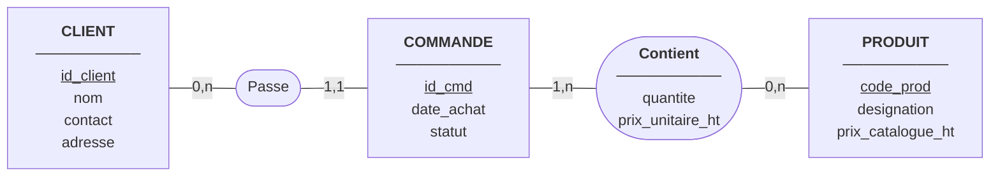

# Modèle Conceptuel de Données (MCD) – MegaShop-B2B

*Les identifiants sont soulignés. Les cardinalités se lisent depuis l'entité vers l'association.*

## Entités

| Entité | Identifiant | Propriétés |
|---|---|---|
| CLIENT | `id_client` (créé, absent du CSV) | nom, contact, adresse |
| COMMANDE | `id_cmd` | date_achat, statut |
| PRODUIT | `code_prod` | designation (libellé), prix_catalogue_ht |

## Associations

| Association | Entités reliées | Cardinalités | Lecture |
|---|---|---|---|
| **Passe** | CLIENT – COMMANDE | 0,n côté client / 1,1 côté commande | Un client passe zéro ou plusieurs commandes ; une commande est passée par un seul client. |
| **Contient** | COMMANDE – PRODUIT | 1,n côté commande / 0,n côté produit | Une commande contient au moins un produit ; un produit peut figurer dans zéro ou plusieurs commandes. |

## Association porteuse : « Contient »

La **quantité** ne dépend ni de la commande seule, ni du produit seul : elle dépend du couple (commande, produit). Exemple : « 2 » n'a de sens que pour « P-01 dans CMD-901 ». Elle est donc portée par l'association **Contient**.

Placer la quantité dans PRODUIT signifierait qu'un produit n'a qu'une seule quantité, la même pour toutes les commandes, ce qui est faux.

Pour la même raison, l'association porte aussi le **prix unitaire figé** au moment de la commande (`prix_unitaire_ht`). Ainsi, un changement de `prix_catalogue_ht` ne modifie pas les commandes déjà passées.

## Donnée exclue

`total_ligne` n'apparaît pas dans le MCD : c'est une donnée calculée (`quantite × prix_unitaire_ht`).