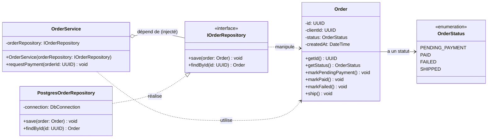

# Diagramme de Classes – Isolation du Repository (MegaShop-B2B)

## Légende

### Relations

| Notation Mermaid | Nom UML | Représentation | Signification dans ce diagramme |
|---|---|---|---|
| `A ..\|> B` | Réalisation | Pointillés + triangle vide | A implémente l'interface B (`PostgresOrderRepository` réalise `IOrderRepository`) |
| `A o-- B` | Agrégation | Trait plein + losange vide côté A | A utilise B sans le posséder ; B est injecté et vit indépendamment (`OrderService` → `IOrderRepository`) |
| `A *-- B` | Composition | Trait plein + losange plein côté A | A possède B ; B meurt avec A (**non utilisée ici**, volontairement) |
| `A ..> B` | Dépendance | Pointillés + flèche ouverte | A se sert de B ponctuellement (paramètre ou valeur de retour) |
| `A --> B` | Association | Trait plein + flèche | A a un attribut de type B (`Order` → `OrderStatus`) |

### Visibilité des membres

| Symbole | Visibilité | Signification |
|---|---|---|
| `+` | public | Accessible depuis n'importe quelle classe |
| `-` | private | Accessible uniquement dans la classe elle-même |
| `#` | protected | Accessible dans la classe et ses sous-classes |

### Stéréotypes

| Stéréotype | Signification |
|---|---|
| `<<interface>>` | Contrat sans implémentation : déclare les méthodes, sans leur code |
| `<<enumeration>>` | Liste fermée de valeurs possibles |

### Lecture des membres
- Attribut : `visibilité nom: Type` (ex. `-id: UUID`)
- Méthode : `visibilité nom(paramètre: Type) TypeRetour` (ex. `+findById(id: UUID) Order`)

## Choix d'architecture

### Pattern Repository
`IOrderRepository` est une **interface** qui expose uniquement des opérations **métier** (`save`, `findById`). Elle ne contient aucune notion technique (SQL, connexion, table). Le détail de la persistance est confiné dans `PostgresOrderRepository`.

### Inversion des dépendances (le « D » de SOLID)
- `OrderService` (module de haut niveau, le métier) dépend d'une **abstraction** : `IOrderRepository`.
- `PostgresOrderRepository` (module de bas niveau, l'infrastructure) dépend **lui aussi** de cette abstraction, puisqu'il la réalise (`..|>`).
- Aucune flèche ne relie `OrderService` à `PostgresOrderRepository` : le service **ignore l'existence de PostgreSQL**.

### Injection de dépendances
Le repository est fourni à `OrderService` via son **constructeur** (`OrderService(orderRepository: IOrderRepository)`). Le service ne fait jamais `new PostgresOrderRepository()`.

### Agrégation et non composition
La relation `OrderService o-- IOrderRepository` est une **agrégation** (losange vide) : le repository est créé à l'extérieur et injecté. Il existe indépendamment du service et peut être partagé. Une **composition** (losange plein) signifierait que le service crée et possède son repository, ce qui recréerait le couplage fort.

## Bénéfices
- **Testabilité** : en test unitaire, on injecte un `InMemoryOrderRepository` (faux repository en mémoire), sans déployer de base de données.
- **Évolutivité** : passer de PostgreSQL à une autre base ne demande qu'une nouvelle classe qui réalise `IOrderRepository`. `OrderService` n'est pas modifié.

## Piège évité
`OrderService` ne dépend **pas** directement de `PostgresOrderRepository`. Un tel lien créerait un couplage fort technologique et rendrait les tests unitaires impossibles sans une vraie base PostgreSQL.