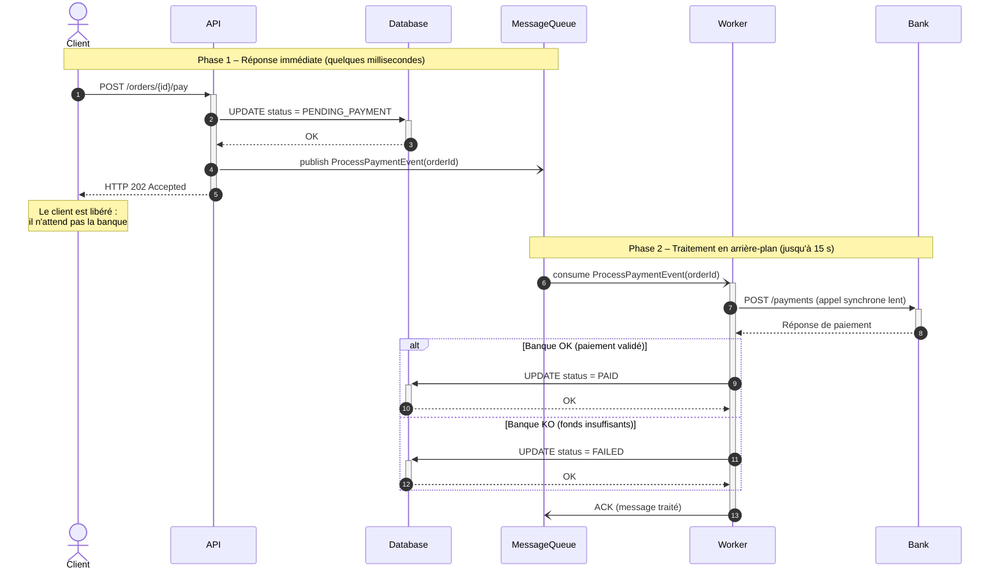

# Diagramme de Séquence – Flux de Paiement Asynchrone (MegaShop-B2B)

## Légende

| Notation Mermaid | Représentation | Signification |
|---|---|---|
| `A->>B` | Trait plein + flèche pleine | **Appel synchrone** (bloquant) : A attend la réponse de B |
| `A-->>B` | Pointillés + flèche pleine | **Réponse** à un appel synchrone |
| `A-)B` | Trait plein + flèche ouverte | **Message asynchrone** (non bloquant) : A envoie et continue sans attendre |
| `+` / `-` après la flèche | Rectangle sur la ligne de vie | **Activation** : période pendant laquelle le participant travaille |
| `alt ... else ... end` | Cadre divisé | **Alternative** : un seul des scénarios s'exécute selon la condition |
| `actor` | Bonhomme | Acteur humain externe au système |

## Lecture du flux

### Phase 1 – Synchrone et rapide (côté utilisateur)
1. Le **Client** clique sur « Payer » : appel synchrone à l'**API**.
2. L'**API** passe immédiatement la commande à `PENDING_PAYMENT` dans la **Database**.
3. L'**API** publie un `ProcessPaymentEvent` dans la **MessageQueue** (RabbitMQ) de façon **asynchrone** : elle n'attend pas qu'il soit traité.
4. L'**API** répond **HTTP 202 Accepted** au Client : la demande est acceptée, et son traitement aura lieu plus tard.

### Phase 2 – Découplée et lente (en arrière-plan)
5. Le **Worker** consomme le message, indépendamment de l'API.
6. Le **Worker** appelle la **Bank** de façon **synchrone** : c'est lui, et non le client, qui attend jusqu'à 15 secondes.
7. Bloc `alt` :
   - **Banque OK** → la commande passe à `PAID`.
   - **Banque KO** → la commande passe à `FAILED`.
8. Le **Worker** acquitte le message (ACK), pour que RabbitMQ le retire de la file.

## Piège évité
La réponse **HTTP 202** est envoyée au Client **avant** que le Worker ne contacte la banque : c'est le message n°5 du diagramme, alors que l'appel à la banque est le n°7. Si elle partait après l'appel bancaire, le client resterait bloqué jusqu'à 15 secondes, et l'architecture redeviendrait bloquante : le Message Broker ne servirait plus à rien.

## Choix complémentaire
L'**ACK** final n'est pas demandé par le cahier des charges. Il reflète le fonctionnement réel de RabbitMQ : tant que le message n'est pas acquitté, il reste dans la file. Si le Worker plante pendant l'appel à la banque, le message est donc redistribué au lieu d'être perdu.