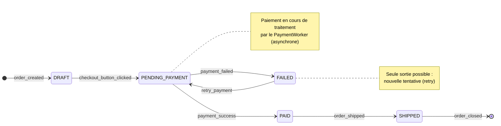

# Machine à États Finis – Cycle de vie d'une Commande (MegaShop-B2B)



## Légende

| Notation Mermaid | Représentation | Signification |
|---|---|---|
| `[*] -->` | Rond plein | **État initial** : point d'entrée unique du cycle de vie |
| `--> [*]` | Rond plein cerclé | **État final** : fin du cycle de vie |
| `ÉTAT` | Rectangle arrondi | **État** stable dans lequel la commande peut se trouver |
| `A --> B : événement` | Flèche étiquetée | **Transition** autorisée, déclenchée par l'événement indiqué |
| `note` | Encadré | Commentaire explicatif sur un état |

## États

| État | Signification |
|---|---|
| `DRAFT` | Commande en cours de constitution (panier), non soumise au paiement |
| `PENDING_PAYMENT` | Paiement demandé, en attente de la réponse de la banque |
| `PAID` | Paiement validé par la banque |
| `FAILED` | Paiement refusé par la banque (ex. fonds insuffisants) |
| `SHIPPED` | Commande expédiée au client |

## Transitions autorisées

| Depuis | Vers | Événement | Déclencheur |
|---|---|---|---|
| `[*]` | `DRAFT` | `order_created` | Le client crée une commande |
| `DRAFT` | `PENDING_PAYMENT` | `checkout_button_clicked` | Le client clique sur « Payer » ; l'API (OrderService) change le statut |
| `PENDING_PAYMENT` | `PAID` | `payment_success` | La banque valide ; le PaymentWorker met à jour la commande |
| `PENDING_PAYMENT` | `FAILED` | `payment_failed` | La banque refuse ; le PaymentWorker met à jour la commande |
| `FAILED` | `PENDING_PAYMENT` | `retry_payment` | Le client relance le paiement (boucle de résilience) |
| `PAID` | `SHIPPED` | `order_shipped` | La logistique expédie la commande |
| `SHIPPED` | `[*]` | `order_closed` | Fin du cycle de vie |

## Transitions interdites (exemples)

Toute transition absente du diagramme est **interdite**. En particulier :

| Transition interdite | Pourquoi |
|---|---|
| `DRAFT → SHIPPED` | Expédier une commande jamais payée |
| `DRAFT → PAID` | Considérer une commande comme payée sans passage par la banque |
| `PENDING_PAYMENT → SHIPPED` | Expédier avant la réponse de la banque |
| `FAILED → PAID` | Valider un paiement refusé sans nouvelle tentative |
| `FAILED → SHIPPED` | Expédier une commande dont le paiement a échoué |
| `SHIPPED → PENDING_PAYMENT` | Faire repayer une commande déjà expédiée |

## Garantie apportée

Le seul chemin qui mène à `SHIPPED` est :

```text
DRAFT → PENDING_PAYMENT → PAID → SHIPPED
```

Il passe **obligatoirement** par `PAID`. Or, `PAID` n'est atteignable que depuis `PENDING_PAYMENT`, via l'événement `payment_success`. Il est donc **impossible** d'expédier une commande sans paiement validé par la banque.

En code, cette machine à états se traduit par des méthodes de l'entité `Order` (`markPendingPayment()`, `markPaid()`, `markFailed()`, `ship()`) qui **vérifient l'état courant** avant de le modifier, et lèvent une erreur si la transition n'est pas autorisée.